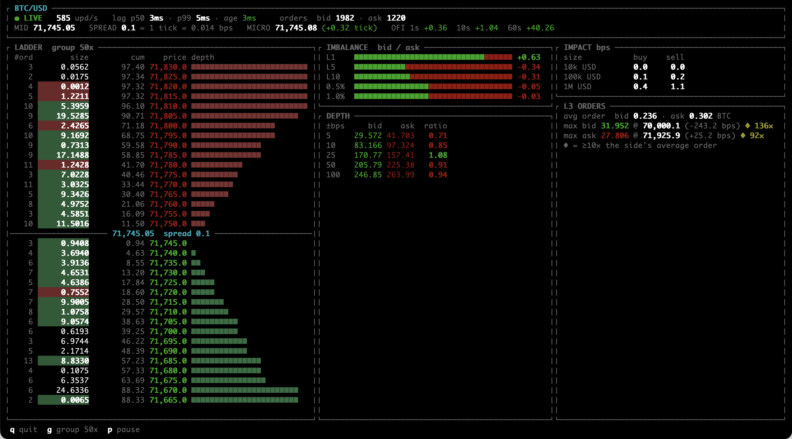

# Kraken Order Book Mirror

[](https://app.codspeed.io//gbeced/kraken-order-book-mirror?utm_source=badge)

A Rust (Tokio) client that keeps a local, order-by-order copy of a Level 3 Kraken spot order book. It authenticates to Kraken, subscribes to the WebSocket v2 [`level3`](https://docs.kraken.com/api/docs/websocket-v2/level3/) channel for one trading pair, applies every snapshot and update to an in-memory book, and verifies each update against Kraken's CRC32 checksum. If the local book ever disagrees with Kraken, the program stops with an error instead of showing a wrong book.

On top of the mirrored book there is a terminal dashboard, a raw frame recorder, and an offline replay benchmark.



See the [dashboard user guide](docs/ui-guide.md) for what each panel shows and how every number is computed.

## Requirements

- Rust 1.99 or newer (`rust-version` in `Cargo.toml`).
- A Kraken API key and secret for `dashboard` and `dump`. `level3` is an authenticated feed, so the key must be allowed to request a WebSocket token. It never needs trading permissions.

The binary does not load `.env`. Export the variables yourself:

```bash
export KRAKEN_API_KEY=...
export KRAKEN_API_SECRET=...
```

Or, from a local `.env` (see `env.example`):

```bash
set -a; source .env; set +a
```

## Build and test

```bash
cargo build --release   # build
cargo test              # unit and integration tests, offline
cargo bench             # Divan micro-benchmarks
```

`cargo test` needs no network and no API keys. The integration tests in `tests/mirror.rs` replay the fixtures in `tests/data/` through the mirror.

The Divan benches (`benches/`) cover single-update applies on a 1000-level book, a replay of `tests/data/btc_usd_stream.log`, and the unit conversion helpers. CodSpeed runs them under CPU simulation in GitHub Actions on every push to `master` and on pull requests.

## Commands

```text
kraken-order-book-mirror dashboard PAIR [DEPTH]
kraken-order-book-mirror dump      PAIR [DEPTH]
kraken-order-book-mirror bench     FILE PAIR [DEPTH]
```

`PAIR` is a Kraken pair name such as `BTC/USD`. `DEPTH` is the number of price levels per side to subscribe to and defaults to `1000`. It must be at least 10, because Kraken's checksum covers the top 10 levels.

### `dashboard`

```bash
cargo run --release -- dashboard BTC/USD
cargo run --release -- dashboard BTC/USD 100
```

Opens a live full-screen order-book dashboard: price ladder, book imbalance, depth bands, market impact, L3 order statistics, and feed health. On small terminals it switches to compact cards. The screen repaints at most every 100 ms.

Keys: `q` or Ctrl-C quit, `g` changes ladder grouping, `p` pauses the display, `Tab` moves to the next symbol.

The program exits on a checksum mismatch, a Kraken error, a closed connection, or 5 seconds without any message. It does not reconnect or refresh its WebSocket token (Kraken tokens last about 15 minutes for new connections).

### `dump`

```bash
cargo run --release -- dump BTC/USD > btc_usd.log
```

Prints every raw `level3` frame, starting with the snapshot, to stdout, one JSON frame per line. Heartbeats, status messages, and subscription acks are dropped. It does not build a book or open the dashboard. The output is the input format for `bench`.

### `bench`

```bash
cargo run --release -- bench btc_usd.log BTC/USD
```

Replays a captured log through the mirror and reports per-update latency of `OrderBookMirror::on_message`. The replay is offline and needs no API keys, but it calls Kraken's public `AssetPairs` endpoint once to look up the pair's price and quantity precision.

- `DEPTH` must match the depth used to capture the file.
- Use `--release`. A debug build prints a warning, and its numbers are not meaningful.
- The first apply or checksum error prints a partial report and exits with status 1.

#### Results

1,000,000 frames of BTC/USD at depth 1000, on a 2.3 GHz 8-Core Intel Core i9:

```text
% cargo run --release bench tmp/btc_usd_1000_1M.log BTC/USD
file        tmp/btc_usd_1000_1M.log
depth       1000
updates     999999
total       5406166.825 µs
throughput  184973.8 msg/s
min         3.803 µs
mean        5.406 µs
p50         5.096 µs
p90         5.765 µs
p95         6.062 µs
p99         14.211 µs
p99.9       38.873 µs
max         173.496 µs
book        present
```

That is about 185,000 updates per second on one core, with a median of about 5 µs per update, including JSON parsing, applying the events, and computing the checksum.

## How it works

1. **Pair info.** `GET /0/public/AssetPairs` gives the pair's price and lot decimals. These become the price and quantity scales of the local book.
2. **Token.** `POST /0/private/GetWebSocketsToken`, signed with HMAC-SHA512, returns a WebSocket token.
3. **Subscribe.** Connect to `wss://ws-l3.kraken.com/v2` and subscribe to `level3` with the pair, the depth, and `snapshot: true`.
4. **Mirror.** A reader task forwards `level3` text frames over a channel without copying them. An updater task applies each frame to `OrderBookMirror`:
   - Prices and quantities are parsed straight from the JSON text into integer counts of the tick and lot size. No floating point and no `Decimal` on the hot path.
   - Each side is a sorted vector of orders: asks by price ascending, bids by price descending, then by time within each price level.
   - After each update the book is cut back to the subscribed depth, and a CRC32 over the top 10 levels per side is compared with Kraken's checksum.
5. **Display.** When a paint is due, the book is converted to decimals and handed to the dashboard.

See Kraken's [L3 checksum guide](https://docs.kraken.com/exchange/guides/websockets/l3-checksum-v2) for the book maintenance and checksum rules.

## Project layout

```text
src/
  main.rs              CLI (clap) and subcommand dispatch
  lib.rs               library crate used by main, tests, and benches
  config.rs            reads KRAKEN_API_KEY / KRAKEN_API_SECRET
  cmds/
    dashboard.rs       live session: reader + updater tasks, dashboard
    dump.rs            live raw frame capture to stdout
    bench.rs           offline replay and latency report
  kraken/
    rest_client.rs     AssetPairs lookup and WebSocket token request
    sign.rs            REST request signing (HMAC-SHA512)
    level3/
      websockets.rs    connect, subscribe, forward level3 frames
      wire.rs          serde types for the JSON frames
      units.rs         decimal text <-> integer unit conversions
      order_book.rs    orders, sorted sides, insert/modify/remove
      mirror.rs        snapshot/update state machine and checksum
  common/              timestamps (ns since epoch) and a small JSON scanner
  tui/                 AI Generated ratatui dashboard: metrics, rendering, layout modes
benches/               Divan / CodSpeed benchmarks
tests/                 integration tests and fixtures (tests/data/)
docs/                  dashboard user guide and screenshot
```

## License

Apache-2.0. See [LICENSE](LICENSE) and [NOTICE](NOTICE).
